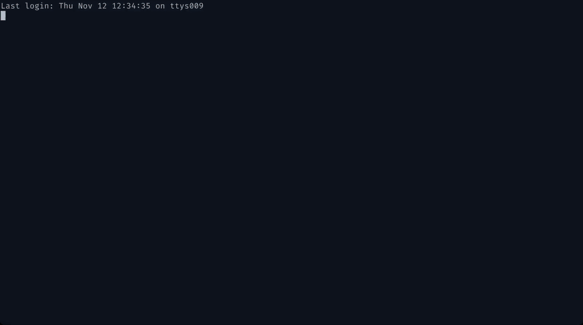
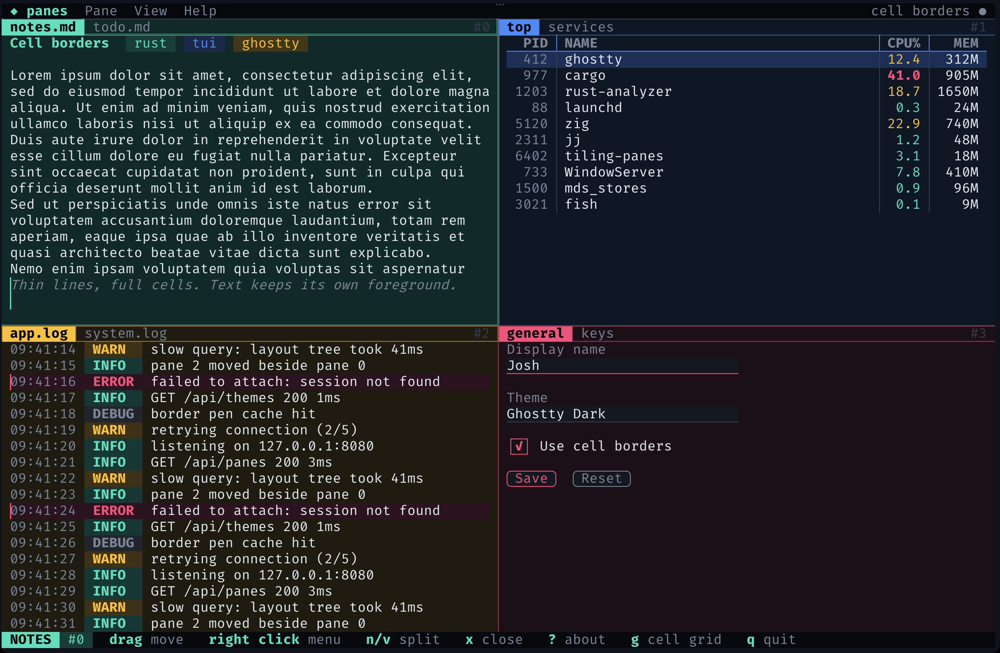
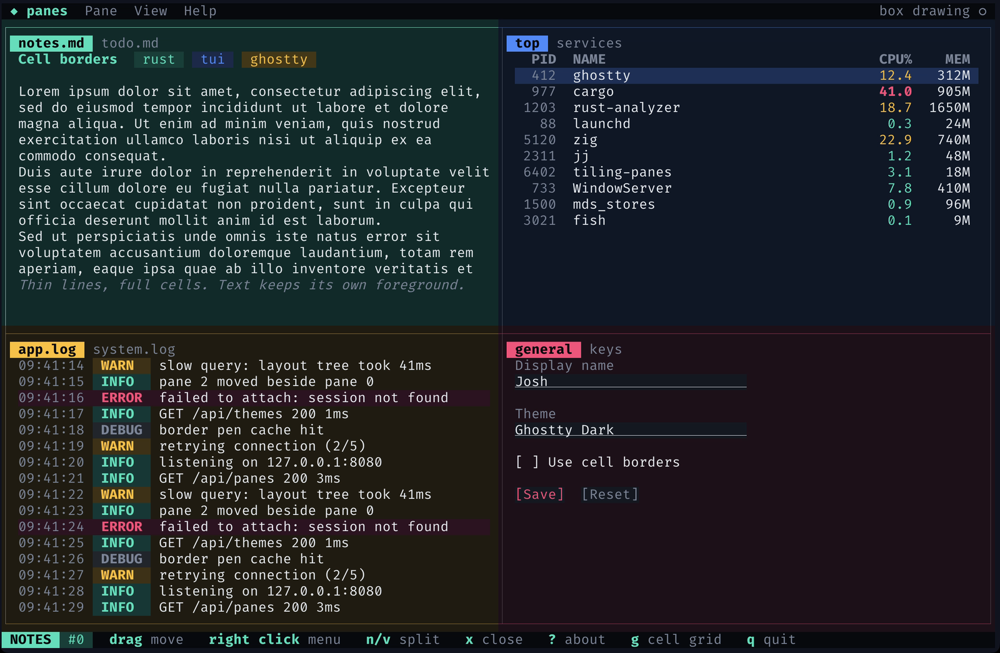

# Cell borders (experimental)

This branch adds experimental support for the [cell border protocol], which draws thin lines on
the edges and centrelines of terminal cells. Because the lines belong to cells rather than
characters, borders, rules and outlines take no columns or rows, and text keeps every cell.

It is a prototype for discussion, not a proposal for Ratatui's API.

## What's here

- `ratatui-core`: a `border` field on `Cell` (`CellBorder`), with segments, colour, width,
  placement, priority, line style, rounded corners, a colour for outside rounded corners and a
  corner radius. Borders take part in the normal buffer diff.
- `ratatui-crossterm`: the backend sends each cell's border as a protocol pen before writing the
  cell, and resets it at the end of each draw. Terminals without the protocol ignore it.
- Two examples that detect support and fall back to box-drawing characters:
  - [`tiling-panes`](examples/apps/tiling-panes/README.md): a multiplexer-style shell with
    draggable, tiling panes.
  - [`cell-border-top`](examples/apps/cell-border-top/README.md): a btop-style system monitor.

## Screenshots

A scripted tour of `tiling-panes` in the experimental Ghostty: dragging panes onto each other to
split and swap them, menus, a dialog, the cell grid (`g`) and the box-drawing comparison (`b`).
There's also a sharper [MP4 version](assets/cell-borders/tiling-panes-tour.mp4) to download.



### Collapsed borders

With `c` (or `TILING_PANES_COLLAPSED=1`), panes sit edge to edge with no outer border, and each
pair of neighbours shares one line, with the lines crossing at the joints. With cell borders the
shared line sits on the edge between two cells, so every pane keeps all of its columns and rows:



The same layout with box-drawing characters, where neighbouring panes overlap by a cell and merge
their borders. Each pane gives up a row and a column to its border:



## Trying it

The protocol is only implemented in an experimental Ghostty branch so far:
[joshka/ghostty `joshka/cell-borders`][ghostty branch]. Building it on macOS needs [Zig] 0.17
and Xcode with its Metal toolchain (`xcodebuild -downloadComponent MetalToolchain`):

```shell
git clone -b joshka/cell-borders https://github.com/joshka/ghostty
cd ghostty
zig build -Doptimize=ReleaseFast
open -na zig-out/Ghostty.app
```

On Linux, `zig build -Doptimize=ReleaseFast` gives `zig-out/bin/ghostty`.

Then, in that Ghostty window, from this checkout:

```shell
cargo run -p tiling-panes
cargo run -p cell-border-top
```

Both demos ask the terminal whether it supports the protocol at startup, and say which mode
they're in. Press `b` in either to compare with box-drawing characters, and `g` to shade
alternate cells so you can see that the lines sit between cells. In any other terminal they run
with box-drawing characters.

[cell border protocol]: https://github.com/joshka/ghostty/blob/joshka/cell-borders/specs/cell-border-protocol.md
[ghostty branch]: https://github.com/joshka/ghostty/tree/joshka/cell-borders
[Zig]: https://ziglang.org/
